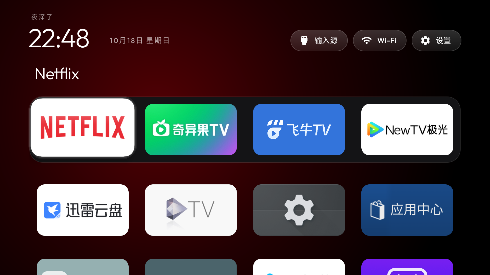

# 索尼国行个人适配版

本分支为上游 CleanYourTV v2.2.0 / `8a8249f`（2026-10-19）的索尼集成候选版，版本 `2.4.0-sony-cn-preview` / 209，targetSdk 34，保留 MIT 许可证。此前在电视上使用的 `2.2.3-sony-cn` / 206 快照保留在本分支历史提交 [`e85d8d0`](https://github.com/roninriddle/tv-vibehack/commit/e85d8d0175790c3535d1abb2e9b66ae4a0491b38)。此候选版合并新的滚动/焦点修复、已合入的恢复入口与中文本地化，以及 #56 最终动画清理；已完成 SDK 编译、签名与隔离包实机短测，随后使用原签名覆盖更新到电视；当前安装为 209，测试应用已移除。

## 实测环境

- Sony K-85XR70（国行）；系统报告 BRAVIA 4K AE2 / BRAVIA_AE2。
- Android 14 / API 34；实读固件 114.602.170.1，CNA。
- 未安装 Google Play 服务、Google 服务框架、Play 商店；本桌面不需要它们。
- 内置 Android 桌面实际为 1920×1080；4K UI 请求未生效，测试后已恢复原显示参数。不据此推断视频或 HDMI 的上限。

## 功能

| 第一排 | Netflix | 银河奇异果 | 飞牛 TV | NewTV 极光 |
| --- | --- | --- | --- | --- |
| 第二排 | 迅雷云盘 | Sparkle TV | 设置 | 应用中心 |

其余应用放在后面。长按确认键打开“移动应用”，方向键移动，确认保存，返回取消。排列保存在本机应用数据中。

中文界面、入口按应用合并、GPU 加速、焦点与背景过渡、两排同时显示，以及“恢复索尼原桌面”图标均保留。恢复图标打开系统默认桌面选择页，由用户选择“电视桌面”；不需要电脑，不会静默修改系统默认项。索尼原桌面仍须保持启用。

更多操作见 [索尼电视使用说明](索尼电视使用说明.md)。本次没有停用或卸载系统应用，也没有已验证的 debloat 清单。

## 构建与本地资料

可按上游要求准备 JDK 17、Android SDK 34 和 Build Tools 34.0.0，再在 `launcher/` 编译。**上游 `build-and-install` 脚本会改默认桌面并停用指定旧桌面，本分支不以该脚本作为索尼试用安装入口。**

另保留本地构建工具 `tools/build-sony.py`：它接收 `--java-home` 和 `--sdk`，从官方 Google Maven / Maven Central 取依赖并通过 SDK 编译、签名。安装包在本地生成，不作为本仓库发布附件。

设备辅助工具预期 Android 官方 Platform Tools 位于 `.local/tools/platform-tools/`，使用本地 ADB 服务端口 15037。新环境应先从 Android 官方下载 Platform Tools，并在该服务端口完成电视无线调试配对；配对地址和连接地址不同。不要将实际地址、配对码或密钥写入源码。

`tools/sony-device.py` 提供备份、试用、打开、启用和恢复；它需要当前连接地址或本机私有配置。已有简洁桌面安装时不会自动建立新的“原始”恢复基线。备份仅包含工具记录的配置，不是整机或完整应用数据备份。

`.local/`、`outputs/`、签名密钥、原始设备备份与连接配置均未提交。更新既有安装包需要保留自己的原签名；不同签名的包不能直接覆盖，不能为了安装而误清除现用桌面数据。

## 证据与限制

此前同日验证涵盖排序预览、取消、保存、应用关闭重开后的排列保持、设置返回、输入菜单显示、默认桌面恢复和重新启用、初始焦点与 Home 键。尚未完成整机重启、数日待机、实际 HDMI 切换、所有流媒体播放或其他固件验证。

下图是此前实际安装的 Sony 定制版，不是后来独立 PR 的通用布局。

## 上游贡献

- [兼容性报告 #29](https://github.com/Gathin23/tv-vibehack/issues/29)
- [通用默认桌面设置入口 #30](https://github.com/Gathin23/tv-vibehack/pull/30)
- [简体中文本地化 #32](https://github.com/Gathin23/tv-vibehack/pull/32)
- [动画过渡贡献 #56](https://github.com/Gathin23/tv-vibehack/pull/56)：为精简仓库分支撤回草稿，动画实现保留在本分支；最终标题回调和本集成版已完成隔离包快速往返短测。
- 排序与无线调试通过既有 PR #19、#24 补充索尼证据，未重复提交同一功能。

本分支保留个人应用顺序和 Sony 专属行为；通用贡献分别整理，不把整个个人适配版作为一个大 PR 提交上游。

## 本次集成与保留项

保留 `launcher_layout` / `app_order` 存储键及原有包名排列，初始八应用顺序与上表一致；`rows_below_dock=1` 显示两排。保留独立“恢复索尼原桌面”入口，通用 Default home 图标默认关闭，避免重复。Android 14 应用可见性增加普通应用与 HOME 查询，以保留原入口发现行为。构建工具从 Gradle 读取版本和 targetSdk，避免产生旧版本号/目标版本的包。

上游 R8 配置保留；本次直接 SDK 构建不等于 Gradle/R8/lint 验证。隔离包实测完成后，用户授权原签名覆盖更新到 209。更新后验证 25 个应用完整排列、默认 HOME、显示参数与停用应用列表均保持原状；Home 键、快速导航和设置返回通过，临时应用已移除。候选包使用贡献工作区的测试签名，不能直接覆盖现用安装；先使用隔离包测试。

## 分支约定

长期仅保留默认分支 `sony`，完整合入原 `main` 与 `sony-cn` 历史，旧分支退役。后续直接在 `sony` 合并 `upstream/main`，验证并保留索尼适配；不必为上游源码另留长期分支。该整理不会更新电视上的安装或改变其应用排列。

## 208 候选版同步记录

同步上游 `b01bb94`：引入五/六列图标自适应、硬件调谐器优先选择、可选直播 action/原厂输入源面板后备入口、泰语资源及上游说明更新。保留 Sony 的 1.12 倍焦点缩放、四列两排布局、八应用初始顺序、launcher_layout/app_order 存储键与独立恢复入口。新增机型参数为空，不配置 TCL 等其他品牌的服务。

直接 SDK 编译、APK 签名与本地布局计算检查已通过；未安装到电视、未测量 208 的内存及性能。README 的 206/早期动画样本不能代表当前候选版。

### 同轮追加：JSON 主题与静态壁纸

最终同步基线为 `b01bb94`，包含上游 JSON 配置覆盖及静态壁纸。未推送覆盖文件或壁纸到电视，默认仍为 Sony 原八应用、四列两排和黑色背景。Config 从本分支的 config.xml 初始化默认项，应用保存顺序继续优先；不自动套用上游 default/six-columns 示例。壁纸相关内存增量和新主题路径均未实机验证，历史动画内存数据不适用于启用壁纸的新版。

## 209 候选版：同步 CleanYourTV v2.2.0

新增模块卡片及中文确认/管理界面、应用变化自动刷新、输入源 action 后备入口、VPN 断开提示、以太网图标和法语/俄语。Sony 排序与卡片刷新交叉已处理：移动时延后软件包事件，保存/取消后刷新；提示不打断移动。保留原存储键、八应用顺序、四列两排、增强动画与恢复入口，模块名称重名检查扩展到本分支额外显示的普通应用与 HOME 名称。

直接 SDK 构建与签名、42 项上游 JVM 测试、九组布局计算、主题脚本和中文参数检查通过；不等于 Gradle/R8/lint 验证。209 隔离包已完成快速导航、排序取消/保存/重开、设置返回、模块发现/默认隐藏/显示/改名确认、移动期间安装事件延后与模块关闭路径实测。增强动画开启且无壁纸时，启动 PSS 约 99.2 MiB、导航后约 83.2 MiB；265 帧中系统报告卡顿帧 0，p95 8 ms。这是整个桌面进程的短测，不是动画额外内存或长期保证。详见 [本次验证范围](docs/sony-209-validation.md)。

长期保留 sony；docs/sony-showcase 是 #126 临时分支，合并后清理。上述 208 同步记录属于历史状态，不代表当前候选版测试结果。

## 正式安装确认

2026-10-19，先备份旧安装包并核对原签名一致，再以保留数据的覆盖方式从 206 更新至 `2.4.0-sony-cn-preview` / 209。版本、完整排列、默认 HOME、Home 键、设置返回及显示参数均已读回验证。未重启整台电视、切换 HDMI 或修改默认桌面。长时间运行、深度待机、壁纸与全部播放场景仍待专项验证。

正式安装后的新短测：启动 PSS 约 110.6 MiB、导航后约 85.6 MiB；279 帧中系统报告卡顿帧 0，p95 8 ms，空闲 CPU 0%、导航约占一个核心的 29%–33%。与上文隔离包样本分开列出，均为整个进程的短测，不能计算动画额外内存。
