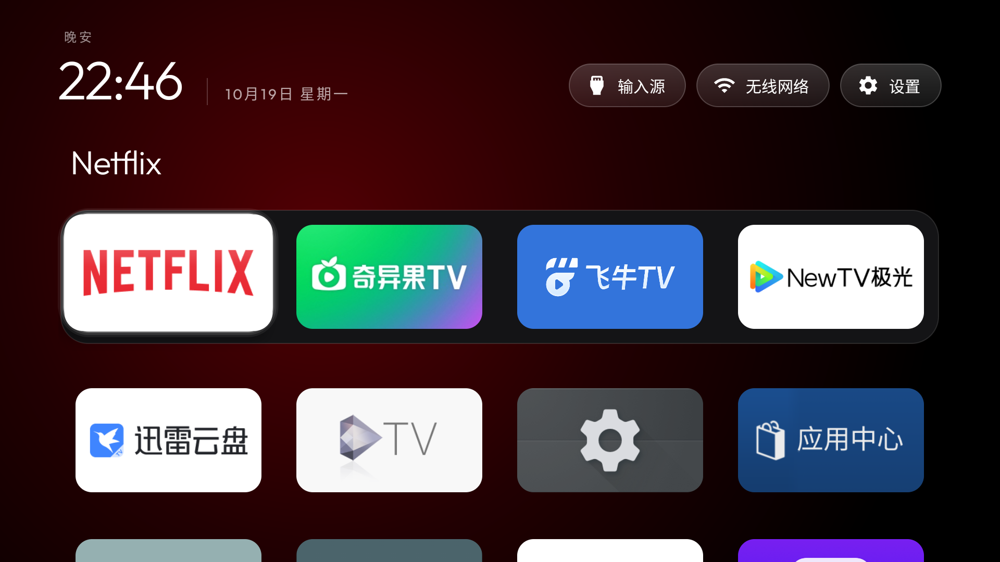

# Sony 209 integration validation

Source: Sony branch integrated with upstream CleanYourTV v2.2.0,
`8a8249f1cd300f85205b9101018f54cc1594f58d`, 19 October 2026.
Version: 2.4.0-sony-cn-preview / 209, minSdk 26, targetSdk 34.

## Verified locally

- Direct official SDK pipeline: resource compilation/linking, javac, D8, zipalign and APK v2/v3
  signature verification. This does not run Gradle, R8 or lint.
- All 42 existing upstream CardsTest/CardFeatureTest JVM tests passed on JDK17 through
  JUnitCore with Android SDK classes: label/caption rules, parser limits, decision serialization,
  card ordering/clashes and the failure guard. Test libraries are not shipped in the APK.
- Nine actual-source geometry combinations: four/five/six columns at three densities.
- Theme shell relative/absolute path, reset and malformed JSON checks passed with stubbed device
  calls. Shipped JSON parsed; bash syntax checked. PowerShell runtime was not tested.
- Sony initial eight-package order, four columns/two rows, saved preference keys, original recovery
  activity source and XML checks passed. All 46 default string names have Chinese resources and
  matching format arguments.
- Normal and isolated APK metadata checked. The isolated application ID is
  com.gathin.tvhome.contribtest, with no HOME intent filter.

## Integration choices

Sony FOCUS_SCALE=1.12, launcher_layout/app_order and the recovery entry are preserved.
Accepted module cards replace only their matching TV component before package deduplication;
ordinary Android and HOME entries still appear. The card-name collision set includes those
extra visible app names, while card eligibility still requires a LEANBACK entry.

Package-change broadcasts defer refresh while a Sony tile move is in progress, then refresh
after save/cancel; on resume the list is refreshed normally. Module prompts wait until movement
ends. Cancel/pause reloads keep approved module cards. Animation cancellation and popup cleanup
both run on pause.

## Isolated TV checks, 19 October 2026

Device: Sony K-85XR70 China, Android 14/API 34, firmware 114.602.170.1. The working launcher
remained build 206. Build 209 used the isolated application ID above and did not register HOME.
Its APK SHA-256 was `d3481c5d74a74d5b4914144e4e1744a50a4eaacd0b7731c43240921647458f19`.

- Chinese UI, initial eight-app order, initial Netflix focus and title verified.
- Rapid left/right return, move preview/cancel, save and force-stop/reopen persistence passed.
  The isolated app's order was restored afterward. Opening system Settings and returning passed.
- A disposable LEANBACK/module fixture triggered the new-card prompt with Keep hidden selected.
  Back retained Hidden; management could show the card; its explicit component opened and returned.
  Newly approved cards followed the previously saved complete application order.
- Updating that fixture's card name during a move deferred its refresh/prompt. Cancel restored
  the order, then requested a new card decision with Hidden selected. Fixture removal passed.
- A second build from the same source, changing only animate_ambient_color=false and
  module_cards=false, passed rapid return and Settings return. Installing the fixture produced
  an ordinary app tile without a module prompt/card. The standard isolated APK was then restored.

### Performance sample

Standard build 209, ambient interpolation enabled, module support enabled, no wallpaper and no
fixture app installed during sampling. At 1920x1080, startup PSS was 101,571 KiB (99.2 MiB),
and navigation PSS was 85,160 KiB (83.2 MiB). Idle CPU samples were 0-1% of one core;
navigation samples were 29-31.2%. Android reported 265 frames, zero janky frames, frame p95 8 ms,
GPU p95 4 ms and zero missed vsyncs. These are whole-process short samples, not animation-only
memory, a peak measurement, a sustained guarantee or a controlled animation-on/off comparison.

### Cleanup and separate wake check

Both temporary packages were removed. Readbacks matched the pre-test default HOME, installed
206 version, first eight app positions, display parameters and disabled-package list.

The owner also authorized one short standby/wake cycle. After verified sleep and disconnecting
the target ADB session, targeted magic packets (unicast and directed broadcast) did not wake the
TV: a readback around 77 seconds after entering standby still reported Asleep. ADB remained
reachable; KEYCODE_WAKEUP (224) then restored Awake. Final HOME/order checks passed and the TV
was left awake. This does not demonstrate network-packet wake or deep/overnight-standby wake.
No network-wake settings were changed.

## Remaining limits

The unsigned source and ordinary contribution APK are unchanged by branch consolidation. Ordinary
contribution APKs use a test key and must not overwrite an existing installation with a different
key. Gradle/R8/lint, signing-key-change prompts, exhaustive
card-limit cases, wallpaper memory, actual HDMI switching, all streaming apps, a full TV reboot,
multi-day running and deep standby remain unverified. Actual default-HOME switching/re-enabling
was tested on build 206; the new 209 regression only opens/cancels the picker.

## Consolidated branch

The default long-term branch is `sony`, merging both former `main` and `sony-cn` histories.
The merge did not change the tested launcher source. Future updates merge `upstream/main` into
`sony` while preserving Sony configuration and saved-order compatibility. Upstream PR #126 was verified merged on 20 October 2026 and its exact temporary
docs/sony-showcase branch was deleted. Other active contribution worktrees were preserved.

## Owner-authorized in-place deployment

After the isolated checks, input-menu opening/cancellation (four HDMI entries plus live TV) and
restore-HOME-picker opening/cancellation also passed. No actual input or default HOME was changed.
The owner then authorized updating the working launcher after the necessary tests.

The installed 206 APK was backed up privately. The normal 209 APK was signed with the original
local key, and its certificate compared equal to the installed 206 certificate. The update APK
SHA-256 was `c31af4521897a285bbeb357bd4fd38ae4f77e86faaf69d7c497e115b35905782`. It was
installed using replace/retain-data mode, without uninstalling or clearing the launcher.

Readback confirmed version 2.4.0-sony-cn-preview / 209. All 25 app positions matched the
pre-update traversal. Default HOME, display parameters and the disabled-app list matched their
baselines. Home opened the updated launcher; initial focus/title, rapid return and system Settings
return passed. Both temporary packages were absent, and the TV was awake. Long-running and
deep-standby checks listed above remain outside this short regression.

A fresh short sample of the installed 209 process (same no-wallpaper/default animation setup)
reported startup PSS 113,283 KiB (110.6 MiB), navigation PSS 87,606 KiB (85.6 MiB), idle CPU 0%
and navigation CPU 29-33% of one core. Android reported 279 frames, zero janky frames, frame p95
8 ms, GPU p95 4 ms and zero missed vsyncs. The same whole-process/short-sample limits apply.

